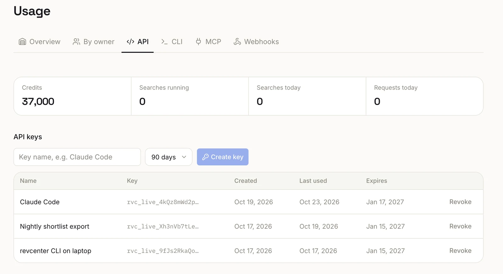

This page is for developers. To use Revcenter in Claude or ChatGPT, you don't need a key: see
[Use Revcenter in Claude or ChatGPT](/tools/connectors).

You reach Revcenter's API one of two ways: connect an app that signs in (OAuth), or make a key in **Settings**.
Either acts for one workspace, as you, with your role there. Every request sends an API key as a bearer token:

```bash
curl https://api.revcenter.ai/v1/me -H "Authorization: Bearer $REVCENTER_API_KEY"
```

Keys look like `rvc_live_…`. A key acts for one workspace, as the person who made it, with their role there.

## Getting a key

| Way | How |
| --- | --- |
| **Settings** | Any member creates one under **Settings → Integrations → API**. It is shown once; copy it or download it as `revcenter.env`. |
| **Claude, ChatGPT** | Any member connects the app ([setup](/tools/connectors)); the connection holds its own key. |

Admins and Editors both make their own keys, unless the workspace's admins turned Editors' keys off. The workspace
needs a trial or a plan. Keys expire after 30, 90 or 365 days.

A workspace can have 5 active keys made in **Settings** (Revcenter support can raise it, up to 50); making one
past the limit is refused with `409 key_limit`. Connecting a chat app never counts toward that and is never refused
for it: connecting Claude or ChatGPT again replaces your earlier connection of that app, and past 5 connected apps,
connecting retires your least recently used one and says which. Keys made in Settings are listed under **API keys**;
connected apps under **Connected apps and devices**, with when each was last used. Both are in
**Settings → Integrations → API**, where any of them can be revoked.

## What a key can do

A key carries its creator's permissions, checked again on every call:

| Creator | The key sees and changes |
| --- | --- |
| **Admin** | Every project in the workspace, its searches, people, shortlists, records, exports and share links. |
| **Editor** | Only the projects that Editor made, and everything under them, exactly as in the app. A project the key creates is theirs. Top-ups answer `403 admin_required`. |

Another member's project or search answers `404`, as one in another workspace does. `GET /v1/me` returns
`acts_as`: the person and their role.

The role is read on every call. Make an Admin an Editor and their keys narrow at once; remove someone from the
workspace (in the app, or in your identity provider) and every key and connected app they made is revoked.

Searches a key launches spend the workspace's credits, as the person could in the app, under the same caps and
approvals.

## Limits for members

Admins set these under **Settings → Integrations → API**, for every member's keys and connected apps, and can override
any of them for one member. Each takes effect on the next call.

| Limit | Default | Past it |
| --- | --- | --- |
| Editors can create keys and connect apps | On | `403 member_keys_disabled` |
| Max credits per search through the API or MCP (at most the workspace's own per-search maximum) | None | `400 member_api_search_cap` |
| Credits a member's API and MCP searches may hold or spend each calendar month (UTC) | None | `402 member_api_budget_reached` |
| Requests a minute, across a member's keys | None | `429 member_rate_limited`, with `Retry-After` |

A search launched without `max_credits` reserves the member's max per search, or what is left of their monthly
budget. Editors see their own limits and this month's use on the same page.

<Frame caption="Settings → Integrations → API: create a key, see when each was last used, and revoke it.">
  
</Frame>

## Giving an agent access

Keep the key out of prompts, transcripts and config files:

1. **Hosted MCP with sign-in.** Claude, ChatGPT and other MCP clients that support sign-in (OAuth) connect to
   `https://api.revcenter.ai/mcp`: you click **Authorize** once and no key is made for you to handle
   ([MCP](/tools/mcp)).
2. **Servers, CI and other agents.** Put the key in a secret manager and expose it as `REVCENTER_API_KEY`; the
   client sends it as `Authorization: Bearer`.

Give each machine or system its own key, so you can revoke one without touching the others.

## Revoking

Revoke a key under **Settings → Integrations → API**; it stops working immediately. Editors see and revoke their own
keys; admins see every key in the workspace, with who made it, when, how (Settings, Claude, ChatGPT or another
app), its scopes and when it was last used, and can revoke any of them. To rotate, create a new key,
deploy it, then revoke the old one. Revcenter stores only a hash and can't show a key again.

## Errors

| Status | Code | Meaning |
| --- | --- | --- |
| `401` | `missing_api_key` · `invalid_api_key` | No key, or it is wrong, expired or revoked |
| `402` | `plan_required` | No active plan |
| `403` | `api_access_disabled` | API access is off for this workspace; contact support |
| `403` | `member_keys_disabled` | Your workspace's admins turned off keys for your seat |
| `409` | `key_limit` | A key made in **Settings** past the workspace's limit; revoke one you no longer use |
| `403` | `insufficient_scope` | The key can't make this call |
| `403` | `admin_required` | Only an admin can do this; the key acts as an Editor |
| `403` | `key_owner_removed` | The person who made the key is no longer in the workspace |
| `400` · `402` · `429` | `member_api_search_cap` · `member_api_budget_reached` · `member_rate_limited` | A [limit for members](#limits-for-members) |

Another workspace's ids answer `404`.
