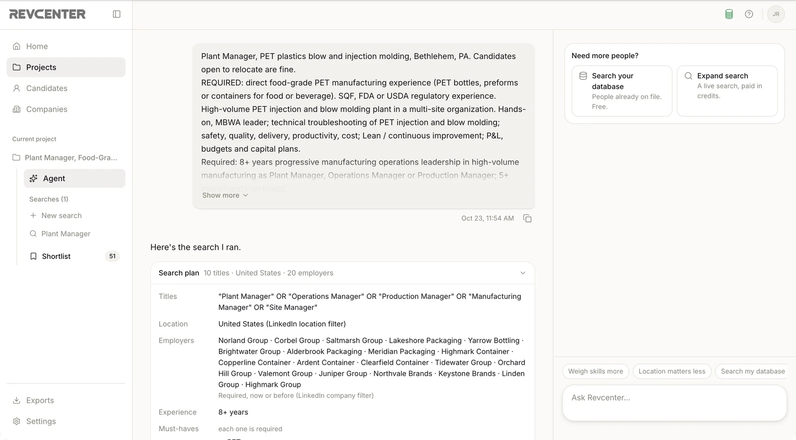
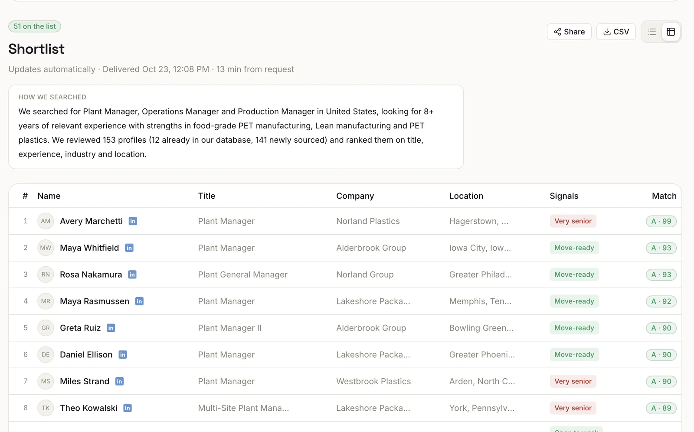

> Agents: the full documentation index is at [/llms.txt](https://docs.revcenter.ai/llms.txt).

A search takes a few minutes. It finds people for your titles and place, reads and scores each profile against
your role, and puts everyone at or above the cut-off (80 by default) on the project's shortlist.

<Frame caption="In the app, a project shows the brief and the search plan Revcenter ran from it.">
  
</Frame>

## The outcome

| Outcome | On the shortlist when the search finished |
| --- | --- |
| Shortlist ready | 6 or more |
| Poor yield | 1 to 5 |
| No results | 0 |

The outcome is fixed when the search finishes. Later changes move the shortlist, not the outcome. The shortlist
counts the whole project, including people earlier searches found.

<Frame caption="The shortlist in the app: how the search ran, then everyone at or above the cut-off with their grade.">
  
</Frame>

## Why a search stopped

| Reason | What it means | What to do |
| --- | --- | --- |
| Few matches (`few_matches`) | Several results pages in a row had nobody who fits. Running more of the same search won't help. | Widen the title or the place, then search again. |
| Everyone found (`discovery_exhausted`) | There was no one left for these titles and places. | Widen the titles or the place for more. |
| Cap used (`budget_exhausted`) | It used the credits you gave it. There may be more people. | Expand the search for more. |
| Most a search can list (`page_cap`) | It reached the most one search can list. | Narrow it, for example to one metro, to reach the closest matches. |
| Cap too small (`cap_too_small`) | The cap was too small to cover a page of people. Nothing was charged. | Start it again with a bigger cap. |
| Stopped (`cancelled`) | You stopped it. It keeps everyone it already read. | Continue it, or leave it. |
| Failed (`failed`) | Something went wrong. Every credit came back. | Start it again; if it fails again, contact support. |

## Before you send the list

When a search finishes, Revcenter says what to check before the list goes to your client: for example that
only a few people were read, that you stopped the search early, or that the place is wider than the role's city.
Read it first. Developers find these sentences in `advice` on the search, and the plan's warnings in
`review.warnings` at launch.

## Getting more people

| Option | What it does | Credits |
| --- | --- | --- |
| **Change the cut-off or requirements** | Scores everyone already found again. You see the before and after first. | Free |
| **Search my database again** | Scores the people your workspace already has against this search. | 3 per new profile, from the search's own cap, while it holds one |
| **Expand** | A new pass for more people on the same role, skipping everyone already found, or the same search continued from where it stopped. | Reserves a new cap; unused credits come back |

Titles and places can't be changed on a finished search: change them in a new search.

## Send the list to your client

Every project has one share link. It always shows the live shortlist, so after a change you send the same link
again. Anyone with the link can open it, so remove anyone who shouldn't be seen first.

| You want to | In the app | In Claude or ChatGPT |
| --- | --- | --- |
| Get the link | **Share** on the project | "Give me the client link" |
| Publish the list to the client's portal | **Publish** | Not in chat |
| Email the list to the client | **Email** | "Email the list to the client": it shows you who gets what and asks first |

Anything that reaches your client is always shown to you first, and only sent when you say yes. Your team's
decisions and notes on a person stay private; the client's own feedback comes back to the project.

## Exports

Download the shortlist, every person a search returned, or your whole candidate database as a spreadsheet (CSV),
with the columns you pick. Details are in the [Exports reference](/guides/exports).
